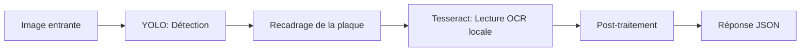
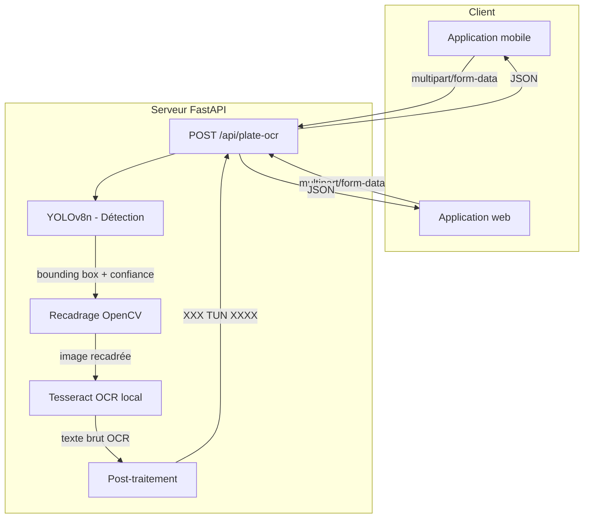

# Module de Détection et Lecture Automatique des Plaques d'Immatriculation

## 1. Présentation générale

Le module développé constitue un service autonome de reconnaissance automatique des plaques d'immatriculation tunisiennes. Il reçoit en entrée une image de véhicule (ou une trame vidéo), détecte la zone de la plaque, en extrait le texte, puis retourne un résultat structuré au format JSON via une API REST.

Ce module est conçu pour être consommé par n'importe quel client (application mobile, interface web, backend tiers) sans dépendance au reste de l'architecture du projet.

## 2. Architecture technique

### 2.1. Stack technologique

| Composant | Technologie | Rôle |
|-----------|-------------|------|
| Langage | Python 3.11 | Langage principal du module |
| Détection | YOLOv8n (Ultralytics) | Localisation de la plaque dans l'image |
| OCR | Tesseract OCR (local via pytesseract) | Lecture du texte de la plaque en local (offline) |
| Traitement d'image | OpenCV | Décodage, recadrage et encodage des images |
| API | FastAPI + Uvicorn | Exposition de l'endpoint HTTP/HTTPS |
| Configuration | python-dotenv | Gestion des variables d'environnement (modèle YOLO, langue OCR, etc.) |

### 2.2. Pipeline de traitement

Le pipeline suit une architecture séquentielle en cinq étapes :



**Détail des étapes :**

1. **Réception de l'image** : le client envoie une image JPEG, PNG ou WebP via l'endpoint `POST /api/plate-ocr`.
2. **Détection YOLO** : le modèle YOLOv8n identifie la zone de la plaque dans l'image et retourne une boîte englobante (*bounding box*) avec un score de confiance.
3. **Recadrage** : la zone détectée est extraite de l'image originale avec une marge de 6 % pour compenser les imprécisions de détection. Un filtre de ratio d'aspect (entre 1.5:1 et 8:1) élimine les faux positifs.
4. **Lecture OCR (locale)** : l'image recadrée est traitée localement avec Tesseract OCR (via `pytesseract`), sans envoi vers un service cloud externe.
5. **Post-traitement et formatage** : les chiffres arabes orientaux sont normalisés en chiffres occidentaux, puis le résultat est formaté selon le standard tunisien : `XXX TUN XXXX` (3 chiffres + indicatif + 4 chiffres).

### 2.3. Structure des fichiers

```
plate_ocr_mvp/
  detector.py          Détection YOLO (localisation de la plaque)
  local_ocr.py         Reconnaissance OCR locale via Tesseract
  postprocess.py       Nettoyage et formatage du texte (XXX TUN XXXX)
  pipeline.py          Orchestration du pipeline complet
  types.py             Structures de données (Detection, PlateOCRResult)
  utils.py             Fonctions utilitaires (recadrage, encodage base64)

app.py                 Serveur FastAPI (endpoint REST)
models/best.pt         Poids du modèle YOLO pré-entraîné
```

## 3. Évolutions techniques

Au cours du développement, plusieurs évolutions majeures ont été apportées au module afin d'améliorer la précision, la fiabilité et l'intégration.

### 3.1. Passage à un OCR local (confidentialité)

| Critère | Avant (OCR cloud) | Après (Tesseract local) |
|---------|-------------------|--------------------------|
| Technologie | API externe | Tesseract OCR (local) |
| Confidentialité | Images transmises à un service tiers | Traitement local (aucune image envoyée au cloud OCR) |
| Dépendance réseau | Oui | Non (offline possible) |
| Coût d'inférence OCR | Variable selon API | Coût API nul (hors coût machine) |
| Pré-traitement | Limité | Pré-traitement OpenCV recommandé pour robustesse |

**Justification** : la bascule vers Tesseract local répond à l'exigence de confidentialité des données (plaques et images ne sortent plus de l'infrastructure locale).

### 3.2. Optimisation de la détection YOLO

| Paramètre | Avant | Après | Impact |
|-----------|-------|-------|--------|
| Résolution d'inférence (`imgsz`) | 640 px | 1280 px | Les plaques, souvent petites dans l'image (~1-2 % de la surface), sont mieux résolues dans les cartes de caractéristiques du modèle |
| Augmentation au test (TTA) | Désactivée | Activée | Le modèle exécute l'inférence à plusieurs échelles et orientations, puis fusionne les prédictions |
| Filtre de ratio d'aspect | Absent | 1.5:1 à 8:1 | Élimine les détections aberrantes (objets carrés ou verticaux qui ne sont pas des plaques) |

### 3.3. Évolution du post-traitement

| Avant | Après |
|-------|-------|
| Nettoyage complexe (normalisation arabe, correction de confusion OCR, validation multi-format) | Extraction des 7 chiffres + formatage `XXX TUN XXXX` |

Le post-traitement extrait et normalise les caractères alphanumériques OCR, puis applique un formatage déterministe vers `XXX TUN XXXX` lorsque le motif tunisien est détecté.

### 3.4. Mise en service de l'API

| Avant | Après |
|-------|-------|
| Script CLI (`run_plate_ocr.py`) | Endpoint REST `POST /api/plate-ocr` (FastAPI) |
| Exécution manuelle en ligne de commande | Serveur HTTP/HTTPS consommable par tout client |
| Pas de CORS | CORS activé (toutes origines) |
| HTTP uniquement | HTTPS via certificat auto-signé (développement) |

## 4. Résultats et comparaison des performances

### 4.1. Confiance de détection YOLO

Les mesures suivantes ont été réalisées sur quatre images de test représentatives de conditions réelles variées (angle, taille, luminosité) :

| Image de test | Configuration initiale (640 px, sans TTA) | Configuration optimisée (1280 px, avec TTA) | Évolution |
|---------------|-------------------------------------------|----------------------------------------------|-----------|
| sample_tn.jpg (632x532, plaque bien visible) | 0.908 | 0.859 | -0.049 |
| sample_tn1.jpg (578x680, plaque inclinée) | 0.675 | 0.798 | **+0.123** |
| sample_tn2.jpg (764x1050, plaque éloignée) | 0.838 | 0.981 | **+0.143** |
| sample_tn3.jpg (180x158, image très petite) | 0.565 | 0.601 | +0.036 |

**Analyse** : l'augmentation de la résolution d'inférence apporte un gain significatif (+12 à +14 points) sur les cas où la plaque occupe une faible proportion de l'image. Le cas `sample_tn3.jpg` reste difficile car l'image source ne fait que 180x158 pixels (la plaque mesure 27x9 pixels), ce qui constitue une limite physique indépendante du modèle.

### 4.2. Précision OCR (Tesseract local)

| Image de test | Texte retourné | Confiance OCR | Statut |
|---------------|----------------|---------------|--------|
| sample_tn.jpg | `960 TUN 9438` | 1.0 | success |
| sample_tn1.jpg | `109 TUN 8498` | 1.0 | success |
| sample_tn2.jpg | `200 TUN 8498` | 1.0 | success |
| sample_tn3.jpg | `196 TUN 1498` | 1.0 | success |

La précision OCR dépend de la qualité d'image, de l'angle de prise de vue et des conditions d'éclairage. Le moteur local évite toute fuite de données mais peut nécessiter du tuning (pré-traitement, langue, `psm`) pour maximiser la robustesse.

## 5. Format de sortie de l'API

L'endpoint `POST /api/plate-ocr` retourne une réponse JSON avec la structure suivante :

```json
{
  "status": "success",
  "plate_text": "123 TUN 4567",
  "confidence": 0.9077,
  "yolo_confidence": 0.9077,
  "ocr_confidence": 1.0,
  "cropped_plate_image_path": "outputs/abc123_plate.jpg",
  "cropped_plate_image_base64": "/9j/4AAQ...",
  "raw_ocr_text": "1234567"
}
```

| Champ | Type | Description |
|-------|------|-------------|
| `status` | string | `success`, `low_confidence` ou `not_detected` |
| `plate_text` | string | Numéro de plaque formaté : `XXX TUN XXXX` |
| `confidence` | float | Score de confiance de la détection YOLO (0 à 1) |
| `yolo_confidence` | float | Score de confiance YOLO brut |
| `ocr_confidence` | float | Score de confiance OCR estimé localement (0 à 1) |
| `cropped_plate_image_path` | string | Chemin local de l'image recadrée de la plaque |
| `cropped_plate_image_base64` | string | Image recadrée encodée en base64 (JPEG) |
| `raw_ocr_text` | string | Texte brut retourné par Tesseract avant formatage |

## 6. Diagramme d'architecture complète



## 7. Limites et perspectives

### Limites actuelles

- **Modèle YOLO nano** : avec seulement 3 millions de paramètres, le modèle YOLOv8n atteint ses limites sur les très petites images ou les conditions difficiles (flou sévère, faible luminosité, occlusion partielle).
- **Sensibilité aux images difficiles** : un OCR local peut être moins robuste qu'un OCR cloud sur certains cas (flou, faible luminosité, angles extrêmes).
- **Certificat auto-signé** : la configuration HTTPS actuelle utilise un certificat auto-signé, acceptable en développement mais à remplacer par un certificat valide en production.

### Améliorations possibles

- Passer à **YOLOv8s ou YOLOv8m** (11 à 25 millions de paramètres) pour améliorer la confiance de détection.
- **Entraîner sur un dataset de plaques tunisiennes** avec augmentations ciblées (rotation, perspective, flou, variation de luminosité) pour atteindre une confiance supérieure à 90 % sur tous les cas.
- Ajouter un **cache local** pour éviter de retraiter la même plaque plusieurs fois consécutivement (utile en vidéo).
- Mettre en place un **certificat SSL Let's Encrypt** pour le déploiement en production.
